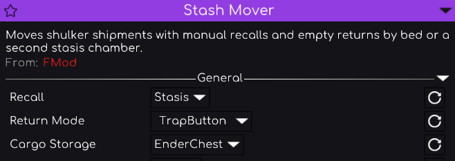
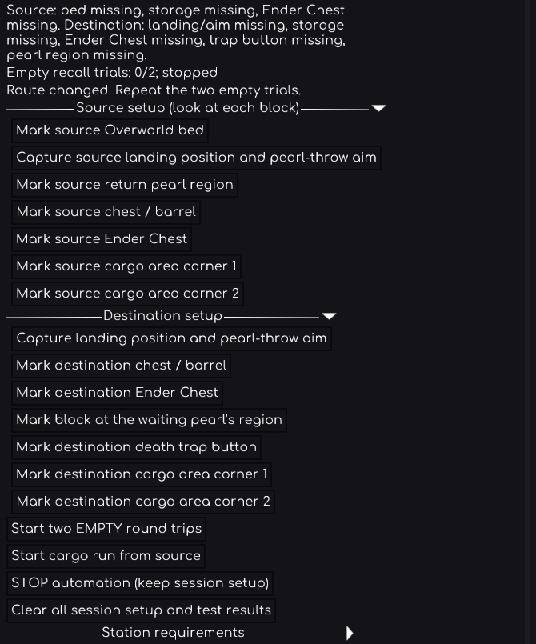

<div align="center">
  

  <h1>FMod</h1>

  <p>Stash hunting, travel and streaming tools for Meteor Client on Minecraft 26.3.</p>

  <p>
    <a href="https://github.com/fluffysnaff/fmod/releases/tag/v0.4.0"><b>Download v0.4.0</b></a>
    &nbsp;|&nbsp;
    <a href="docs/FEATURES.md">All features</a>
    &nbsp;|&nbsp;
    <a href="#stash-mover-setup">Stash Mover setup</a>
    &nbsp;|&nbsp;
    <a href="#build-from-source">Build from source</a>
  </p>
</div>

FMod is an addon for [Meteor Client](https://meteorclient.com/), a Minecraft client mod. All of its modules are in the **FMod** category of Meteor's menu.

The **0.4.0 release** adds commandless Stash Mover returns, EventlessFly, KnockbackTweaks, SeedMap, and an in-game stash map. See the [feature guide](docs/FEATURES.md) for settings and optional mods.

## Features

- **Find stashes.** Search Area moves you through a rectangle or a spiral. Better Stash Finder saves every chest it finds to CSV and JSON files.
- **Follow trails.** Old Chunk Notifier tells you when you reach chunks from an older Minecraft version, where players were long ago. TrailFollower and Trail Maker follow a trail for you.
- **Use Meteor flight while following trails.** TrailFollower can enable Meteor's built-in ElytraFly with your existing settings, and restores only the activation state it owns.
- **Fly with a controlled speed ramp.** VolytraFly brings Volizray's 6b6t flight module, navigation, avoidance and HUDs into FMod. Its default requested ceiling approaches 300 blocks/s; live server acceptance must be tested.
- **Move supplies.** Stash Mover loads filled shulker boxes, verifies delivery, and returns the courier empty. [Set up your route](#stash-mover-setup).
- **Find stored items.** ChestTracker remembers opened containers, ChestIndex checks reachable storage, ShulkerOverview previews box contents, and DubCounter counts loaded storage and capacity.
- **Keep records and prepare supplies.** SignHistorian records observed sign changes, SignatureSign fills sign templates, StashBrander renames items through an anvil, and RoadTrip monitors travel progress and optional logout conditions.
- **Conceal coordinate displays.** Coord Hider can hide coordinates or show securely generated synthetic coordinates in F3, the Meteor HUD and recognised text. Actual movement and saved data stay unchanged.
- **Get alerts.** Auto Log Plus logs you out in more situations. Discord Notifs sends messages to your own Discord webhook.
- **Move with commands.** `.tp`, `.autoclip`, `.shclip` and `.dclip` teleport you short distances or through blocks.

[All features and settings](docs/FEATURES.md)

## Install

1. Install [Meteor Client](https://meteorclient.com/download) for Minecraft 26.3. You need Fabric Loader 0.19.5 or newer and Java 25 or newer.
2. Download `fmod-0.4.0.jar` from the [v0.4.0 release](https://github.com/fluffysnaff/fmod/releases/tag/v0.4.0) and put it in your `.minecraft/mods` folder.
3. Start Minecraft with your Fabric profile. Press Right Shift to open Meteor's menu.

The map and trail modules need Xaero's World Map, Xaero's Minimap and XaeroPlus. TrailFollower also needs Baritone. Without these mods, the modules that need them do not appear. See the [tested versions](docs/FEATURES.md#optional-mods).

Many servers do not allow client mods. Read a server's rules before you use FMod on it.

## Stash Mover setup

In game, open Meteor with **Right Shift**, then right-click **Stash Mover** in the **FMod** category. Enable the module on the courier account before marking either station.

### 1. Choose the return mode



| Return mode | What to set up |
| --- | --- |
| **KillCommand** | Set and mark the source bed. The server must offer `/kill` to the courier. |
| **TrapButton** | Set and mark the source bed. Build a resettable redstone trap at the destination, then look at its reachable button and click **Mark destination death trap button**. The courier presses it after unloading. |
| **ReturnPearl** | Set up a stasis chamber and an operator at each Overworld station. Use this for two-way stasis with vanilla's default pearl behavior. |

For **KillCommand** and **TrapButton**, a stasis recall needs the destination pearl to survive the courier's death. If the server supports **Tpa**, you can use it for the outbound leg instead. The destination operator accepts each request.

### 2. Mark stations and run the empty trials



1. Look at each block before opening the setup menu to mark it. Mark a reachable **chest or barrel** at each station. Mark both Ender Chests if you use the default **EnderChest** cargo mode.
2. Capture the destination landing pose. For **Stasis**, aim into the chamber while capturing the pose, then mark the resting pearl region. For **ReturnPearl**, capture the source pose and mark the source chamber too. Stock spare pearls at each station where the courier will rearm.
3. Press **Start two EMPTY round trips** with the courier's inventory and equipment empty. Start at the destination for **KillCommand** or **TrapButton**. For **ReturnPearl**, have the courier pre-arm its destination pearl, then bring it to the source to start.
4. Trigger each recall when the module says the courier is ready. After both trials finish at the source, stock the source with filled shulker boxes and select **Start cargo run from source**.

See the [full Stash Mover guide](docs/FEATURES.md#stash-mover) for trap reset requirements, cargo settings, and troubleshooting.

## Build from source

With JDK 25 set as `JAVA_HOME`:

```bash
git clone https://github.com/fluffysnaff/fmod.git
cd fmod
bash ./gradlew build
```

On Windows, use `.\gradlew.bat build`. The jar is written to `build/libs/`.

## License and credits

EventlessFly, KnockbackTweaks, SeedMap and FrameDupe improvements draw on [Meteor Satellite Addon](https://github.com/crazycat256/meteor-satellite-addon).

FMod is licensed under the [GNU General Public License version 3](LICENSE). It builds on work by [miles352 and the stashhunting contributors](https://github.com/miles352/meteor-stashhunting-addon/), the [Meteor Client team](https://github.com/MeteorDevelopment/meteor-client/), [rfresh2/NoTextureRotations](https://github.com/rfresh2/NoTextureRotations/) and [JorianWoltjer/LiveOverflowMod](https://github.com/JorianWoltjer/LiveOverflowMod). [THIRD_PARTY_NOTICES.md](THIRD_PARTY_NOTICES.md) explains the source and license status of the imported code.
