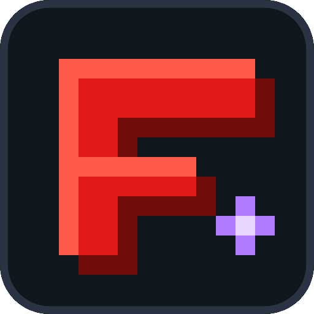
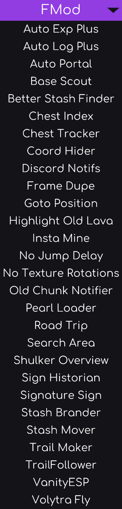

<div align="center">
  

  <h1>FMod</h1>

  <p>Stash hunting, travel and streaming tools for Meteor Client on Minecraft 26.3.</p>

  <p>
    <a href="https://github.com/fluffysnaff/fmod/releases/tag/v0.2.0"><b>Download v0.2.0 (prerelease)</b></a>
    &nbsp;|&nbsp;
    <a href="docs/FEATURES.md">All features</a>
    &nbsp;|&nbsp;
    <a href="#build-from-source">Build from source</a>
  </p>
</div>

FMod is an addon for [Meteor Client](https://meteorclient.com/), a Minecraft client mod. All of its modules are in the **FMod** category of Meteor's menu.

## Features

<table>
<tr>
<td valign="top">

- **Find stashes.** Search Area moves you through a rectangle or a spiral. Better Stash Finder saves every chest it finds to CSV and JSON files.
- **Follow trails.** Old Chunk Notifier tells you when you reach chunks from an older Minecraft version, where players were long ago. TrailFollower and Trail Maker follow a trail for you.
- **Travel by elytra.** ElytraFlyPlusPlus passes highway obstacles. Pitch40Util and AFKVanillaFly keep you flying while you are away.
- **Stream safely.** Coord Hider hides coordinates in F3, the Meteor HUD and chat. It changes only what is on your screen.
- **Get alerts.** Auto Log Plus logs you out in more situations. Discord Notifs sends messages to your own Discord webhook.
- **Move with commands.** `.tp`, `.autoclip`, `.shclip` and `.dclip` teleport you short distances or through blocks.

[All features and settings](docs/FEATURES.md)

</td>
<td valign="top" width="193">
  
</td>
</tr>
</table>

## Install

1. Install [Meteor Client](https://meteorclient.com/download) for Minecraft 26.3. You need Fabric Loader 0.19.5 or newer and Java 25 or newer.
2. Download `fmod-<version>.jar` from the [v0.2.0 prerelease](https://github.com/fluffysnaff/fmod/releases/tag/v0.2.0) and put it in your `.minecraft/mods` folder.
3. Start Minecraft with your Fabric profile. Press Right Shift to open Meteor's menu.

The map and trail modules need Xaero's World Map, Xaero's Minimap and XaeroPlus. TrailFollower and ElytraFlyPlusPlus also need Baritone. Without these mods, the modules that need them do not appear. See the [tested versions](docs/FEATURES.md#optional-mods).

Many servers do not allow client mods. Read a server's rules before you use FMod on it.

## Build from source

With JDK 25 set as `JAVA_HOME`:

```bash
git clone https://github.com/fluffysnaff/fmod.git
cd fmod
bash ./gradlew build
```

On Windows, use `.\gradlew.bat build`. The jar is written to `build/libs/`.

## License and credits

FMod is licensed under the [GNU General Public License version 3](LICENSE). It builds on work by [miles352 and the stashhunting contributors](https://github.com/miles352/meteor-stashhunting-addon/), the [Meteor Client team](https://github.com/MeteorDevelopment/meteor-client/), [rfresh2/NoTextureRotations](https://github.com/rfresh2/NoTextureRotations/) and [JorianWoltjer/LiveOverflowMod](https://github.com/JorianWoltjer/LiveOverflowMod). [THIRD_PARTY_NOTICES.md](THIRD_PARTY_NOTICES.md) explains the source and license status of the imported code.
